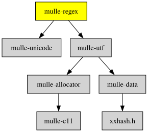

# mulle-regex

#### > This is a unicode interpretation of the Henry Spencer regexp

# 📣 Unicode regex library

> This is a unicode interpretation of the Henry Spencer regexp
> code.  
>
> The code is in general less forgiving than the original code, for
> example substituting (a) with \1\2 is not allowed anymore. For 
> substitution you have to give the length of the destination buffer,
> to protect against overflows. There are a few added convenience
> methods.
>
> Copyright (c) 2011 Mulle kybernetiK
> Additional coding by Nat!

Copyright (c) 1986, 1993, 1995 by University of Toronto.
Written by Henry Spencer.  Not derived from licensed software.
Permission is granted to anyone to use this software for any
purpose on any computer system, and to redistribute it in any way,
subject to the following restrictions:

1. The author is not responsible for the consequences of use of
this software, no matter how awful, even if they arise
from defects in it.

2. The origin of this software must not be misrepresented, either
by explicit claim or by omission.

3. Altered versions must be plainly marked as such, and must not
be misrepresented (by explicit claim or omission) as being
the original software.

4. This notice must not be removed or altered.
This is a revision of my well-known regular-expression package, regexp(3).
It gives C programs the ability to use egrep-style regular expressions, and
does it in a much cleaner fashion than the analogous routines in SysV.
It is not, alas, fully POSIX.2-compliant; that is hard.  (I'm working on
a full reimplementation that will do that.)

This version is the one which is examined and explained in one chapter of
"Software Solutions in C" (Dale Schumacher, ed.; AP Professional 1994;
ISBN 0-12-632360-7), plus a couple of insignificant updates, plus one
significant bug fix (done 10 Nov 1995).

Although this package was inspired by the Bell V8 regexp(3), this
implementation is *NOT* AT&T/Bell code, and is not derived from licensed
software.  Even though U of T is a V8 licensee.  This software is based on
a V8 manual page sent to me by Dennis Ritchie (the manual page enclosed
here is a complete rewrite and hence is not covered by AT&T copyright).
I admit to some familiarity with regular-expression implementations of
the past, but the only one that this code traces any ancestry to is the
one published in Kernighan & Plauger's "Software Tools" (from which
this one draws ideas but not code).

Simplistically:  put this stuff into a source directory, inspect Makefile
for compilation options that need changing to suit your local environment,
and then do "make".  This compiles the regexp(3) functions, builds a
library containing them, compiles a test program, and runs a large set of
regression tests.  If there are no complaints, then put regexp.h into
/usr/include, add regexp.o, regsub.o, and regerror.o into your C library
(or put libre.a into /usr/lib), and install regexp.3 (perhaps with slight
modifications) in your manual-pages directory. 

The files are:

    COPYRIGHT	copyright notice
    README		this text
    Makefile	instructions to make everything
    regexp.3	manual page
    regexp.h	header file, for /usr/include
    regexp.c	source for regcomp() and regexec()
    regsub.c	source for regsub()
    regerror.c	source for default regerror()
    regmagic.h	internal header file
    try.c		source for test program
    timer.c		source for timing program
    tests		test list for try and timer

This implementation uses nondeterministic automata rather than the
deterministic ones found in some other implementations, which makes it
simpler, smaller, and faster at compiling regular expressions, but slower
at executing them.  Many users have found the speed perfectly adequate,
although replacing the insides of egrep with this code would be a mistake.

This stuff should be pretty portable, given an ANSI C compiler and
appropriate option settings.  There are no "reserved" char values except for
NUL, and no special significance is attached to the top bit of chars.
The string(3) functions are used a fair bit, on the grounds that they are
probably faster than coding the operations in line.  Some attempts at code
tuning have been made, but this is invariably a bit machine-specific.

This distribution lives at ftp://ftp.zoo.toronto.edu/pub/bookregexp.{tar|shar}
at present.


| Release Version                                       | Release Notes
|-------------------------------------------------------|--------------
|  [](//github.com/mulle-c/mulle-regex/actions)| [RELEASENOTES](RELEASENOTES.md) |


### You are here




## Add

**This project is a component of the [mulle-core](//github.com/mulle-core/mulle-core) library. As such you usually will *not* add or install it
individually, unless you specifically do not want to link against
`mulle-core`.**


### Add as an individual component

Use [mulle-sde](//github.com/mulle-sde) to add mulle-regex to your project:

``` sh
mulle-sde add github:mulle-c/mulle-regex
```

To only add the sources of mulle-regex with dependency
sources use [clib](https://github.com/clibs/clib):


``` sh
clib install --out src/mulle-c mulle-c/mulle-regex
```

Add `-isystem src/mulle-c` to your `CFLAGS` and compile all the sources that were downloaded with your project.


## Install

### Install with mulle-sde

Use [mulle-sde](//github.com/mulle-sde) to build and install mulle-regex and all dependencies:

``` sh
mulle-sde install --prefix /usr/local \
   https://github.com/mulle-c/mulle-regex/archive/latest.tar.gz
```

### Manual Installation

Install the requirements:

| Requirements                                 | Description
|----------------------------------------------|-----------------------
| [mulle-utf](https://github.com/mulle-c/mulle-utf)             | 🔤 UTF8-16-32 analysis and manipulation library

Install **mulle-regex** into `/usr/local` with [cmake](https://cmake.org):

``` sh
cmake -B build \
      -DCMAKE_INSTALL_PREFIX=/usr/local \
      -DCMAKE_PREFIX_PATH=/usr/local \
      -DCMAKE_BUILD_TYPE=Release &&
cmake --build build --config Release &&
cmake --install build --config Release
```


## Author

[Nat!](https://mulle-kybernetik.com/weblog) for Mulle kybernetiK


